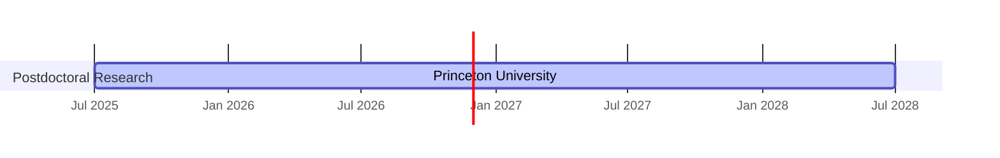
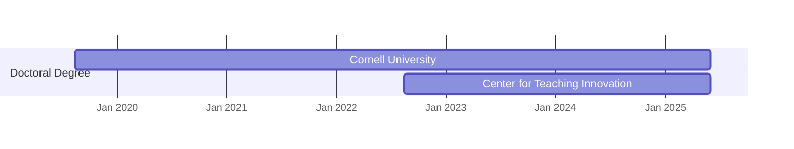
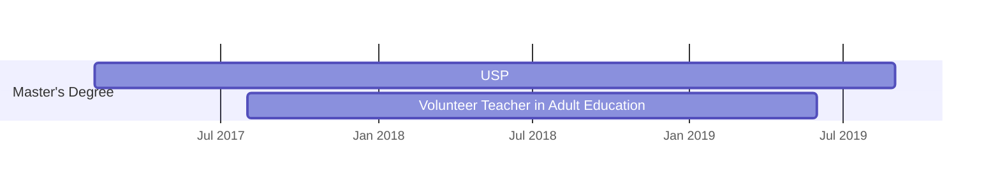
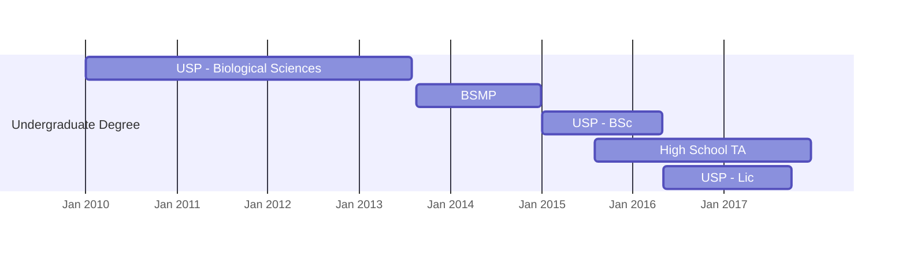
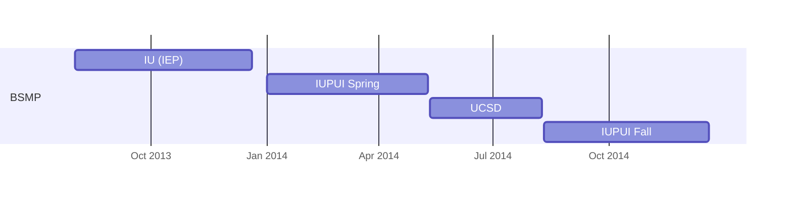

## Postdoctoral Research

**[Princeton University](https://www.princeton.edu/) - [Department of Ecology and Evolutionary Biology](https://eeb.princeton.edu/)**
 - Advisor: Dr. Bernard Kim.
 - July 2025 - present.

## Doctoral Degree

**[Cornell University](https://www.cornell.edu/) - [Department of Entomology](https://cals.cornell.edu/entomology)**
 - Doctor of Philosophy in Entomology.
 - Major Professor: Dr. Patrick O'Grady.
 - August 2019 - May 2025.

**[Center for Teaching Innovation](https://teaching.cornell.edu/) - [Graduate Teaching Fellow](https://teaching.cornell.edu/cti-graduate-teaching-fellowship)**
 - Supervisor: Dr. Derina Samuel.
 - August 2022 - May 2025.

## Master's Degree

**[Universidade de São Paulo (USP)](https://www5.usp.br/) - [Departamento de Genética e Biologia Evolutiva](https://posgenetica.ib.usp.br/#)**
 - Master of Science in Genetics and Evolutionary Biology.
 - Major Professor: Dr. Carlos Vilela.
 - February 2017 - August 2019.

**Volunteer Teacher in Adult Education** ([more details](/teaching_portfolio/other_experiences/))
 - Escola Nova Lourenço Castanho.
 - I taught science classes for adults from underrepresented populations who did not have a chance to study when they were younger.
 - Fall 2017 - Spring 2019.

## Undergraduate Degree

**[Universidade de São Paulo (USP)](https://www5.usp.br/) - Biological Sciences**
 - I attended the 6-year program of Biological Sciences at USP, ranked among the leading universities in Latin America by Times Higher Education.

**[Brazil Scientific Mobility Program (BSMP)](https://www.iie.org/programs/brazil-scientific-mobility/)**
 - I received this exchange scholarship, which supported my studies at several American universities from August 2013 to December 2014 (details below).

**USP - [Bachelor of Science](https://uspdigital.usp.br/jupiterweb/listarGradeCurricular?codcg=41&codcur=41012&codhab=204&tipo=N)**
 - After returning to Brazil, I completed the requirements of the Bachelor of Science degree.
 - I conducted independent research projects under the supervision of Dr. Carlos Vilela.
 - Graduation: April 2016.

**High School Teaching Assistant** ([more details](/teaching_portfolio/other_experiences/))
 - Biology teaching assistant at the Escola Nova Lourenço Castanho.
 - Closely following the students' personal growth and intellectual development inspired me to pursue the Undergraduate Degree in Biology Education.
 - Fall 2015 - Fall 2017.

**USP - [Biology Education (Licenciatura)](https://uspdigital.usp.br/jupiterweb/listarGradeCurricular?codcg=41&codcur=41012&codhab=304&tipo=N)**
 - I subsequently completed the Undergraduate Degree in Biology Education (Licenciatura), studying theories of education while gaining practical teaching experience.
 - Graduation: September 2017.

## Brazil Scientific Mobility Program

**[Indiana University, Bloomington](https://bloomington.iu.edu/index.html) - [Intensive English Program](https://dsls.indiana.edu/for-international-students/iep/index.html)**
 - I attended the two highest levels (6 and 7) of the program to prepare for further academic studies in American universities.
 - Fall 2013.

**[Indiana University-Purdue University Indianapolis](https://indianapolis.iu.edu/) (now Indiana University Indianapolis)**
 - I took Biology-related courses at the Purdue School of Science over two semesters.
 - Spring and Fall 2014.

**[University of California, San Diego](https://ucsd.edu/)**
 - I joined a research project under the supervision of Dr. Maxi Richmond and Dr. Teri Markow.
 - Summer 2014.
